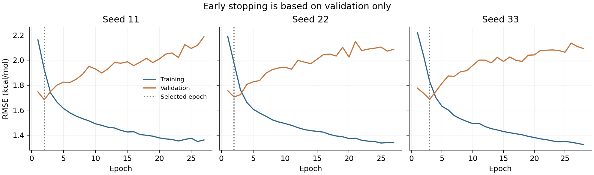
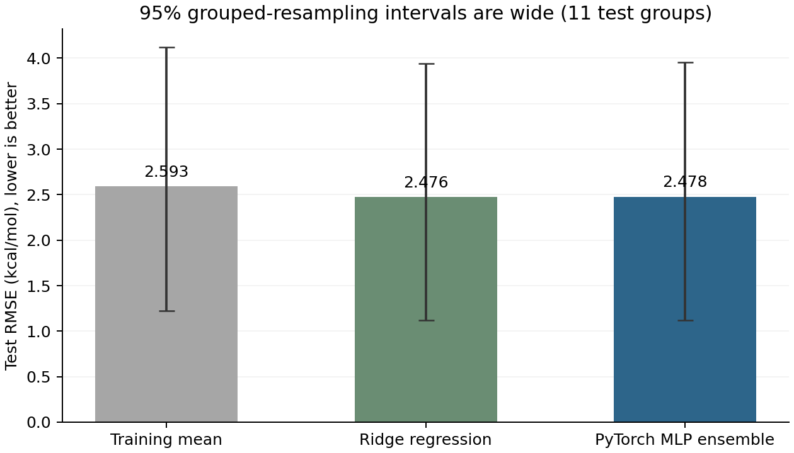

# PyTorch Mutation ΔΔG Benchmark

基于公开 SKEMPI 2.0 实验数据的蛋白互作突变效应回归项目，覆盖数据审计、关系分组拆分、PyTorch 训练、验证集早停、独立测试和基线比较。

这是一个 AI 辅助完成的学习与研究基准。模型不是通用抗体亲和力预测工具，也不直接评价从头设计的多肽序列。

## 实际完成

- 原始数据 7,085 条；清洗及重复测量汇总后 3,998 条。
- 按同 PDB、显式 hold-out PDB 链接和可识别的相同蛋白名称构建 72 个关联组；组间不交叉。
- 训练 / 验证 / 测试记录数为 3,010 / 510 / 478。
- 使用 `TensorDataset`、`DataLoader`、`nn.Module`、反向传播、AdamW 和验证集早停。
- 三个固定随机种子，与均值、岭回归基线比较，保留全部逐条预测。
- 6 项单元检查及保存权重、预处理和报告一致性检查通过。

## 留出测试结果

| 模型 | RMSE kcal/mol | MAE kcal/mol | Spearman |
|---|---:|---:|---:|
| 训练均值 | 2.593 | 1.711 | 不适用 |
| 岭回归 | 2.476 | 1.609 | 0.456 |
| PyTorch MLP 三种子集成 | 2.478 | 1.592 | 0.549 |

神经网络的 RMSE 没有超过岭回归；R² 约 0.046。测试集只有 11 个关联组，按组重采样区间较宽。抗体标签测试子集仅 17 条且表现较弱，不能据此宣称抗体优化能力。





完整分析见 [实际结果报告](results/run_001/REPORT.md)。

## 任务和特征

标签遵循数据源定义：`ΔΔG = RT ln(Kd_mut / Kd_wt)`，单位 kcal/mol。负值表示该实验条件下突变后结合更紧，正值表示变弱；不是绝对 Kd。

451 维输入包括原始 / 突变氨基酸、替换类别、结构区域注释、伙伴侧别、突变数量和温度。网络为 `451 → 64 → 32 → 1`，31,041 个可训练参数。预处理仅在训练集拟合，测试集不用于选 epoch 或岭回归正则化强度。

## 安装与复现

使用 Python 3.12 环境。已运行的版本见 [environment.json](environment.json)。

```bash
python -m venv .venv
# Linux / macOS
source .venv/bin/activate
# Windows PowerShell 使用 .venv\Scripts\Activate.ps1
pip install -r requirements.txt

python -m unittest discover -s tests -v
python train.py --out results/run_002 --epochs 200 --patience 25 --threads 2
python check_run.py --run results/run_002
python make_report.py --run results/run_002
```

训练命令只接受尚不存在的输出目录，不覆盖已归档实验。三个种子为 11、22、33；训练默认使用 CPU。其他版本或硬件下不承诺逐比特一致。

## 单条推理

```bash
python predict.py --run results/run_001 --mutations AA10V --locations COR \
  --partner1 A --partner2 B --temperature 298
```

`AA10V` 表示 A 链第 10 位 Ala→Val，只是接口演示，并不对应已验证的候选位点。多个突变用逗号分隔，位置标签应逐个对应。模型没有抗原序列或三维界面上下文；不能给任意新肽直接预测亲和力。

## 文件结构

```text
src/data.py           清洗、标签、分组和特征
src/model.py          PyTorch MLP
src/metrics.py        指标和按组重采样
train.py              训练、基线、早停、测试、保存
predict.py            权重加载和单条推理
check_run.py          运行结果一致性检查
make_report.py        科学绘图与报告
tests/                数据规则检查
data/raw/             未修改的原始 CSV
results/run_001/      本次真实权重、指标、预测和图
```

## 局限

分组基于元数据，没有完成完整序列同源聚类，也不是整个抗体类别留出的评估。组大小和实验条件不均衡。重复测量按同复合物、突变和温度汇总，仍可能混合不同实验条件。测试集现已公开用于报告，后续模型开发需要新的独立测试或嵌套分组交叉验证。

## 数据来源与许可

数据来自 [SKEMPI 2.0](https://life.bsc.es/pid/skempi2/)，按来源标明的 CC BY 4.0 条件保留署名；详见 [DATA_SOURCE.md](DATA_SOURCE.md)。

Jankauskaite et al. (2019). SKEMPI 2.0: an updated benchmark of changes in protein–protein binding energy, kinetics and thermodynamics upon mutation. [DOI](https://doi.org/10.1093/bioinformatics/bty635)。

原始数据保持不变；清洗、特征、拆分和预测属于本项目派生结果。项目不代表数据作者背书。代码尚未指定开源许可；数据许可与代码许可应分别理解。
